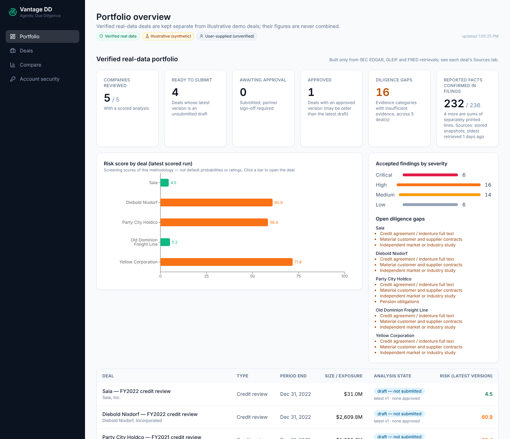
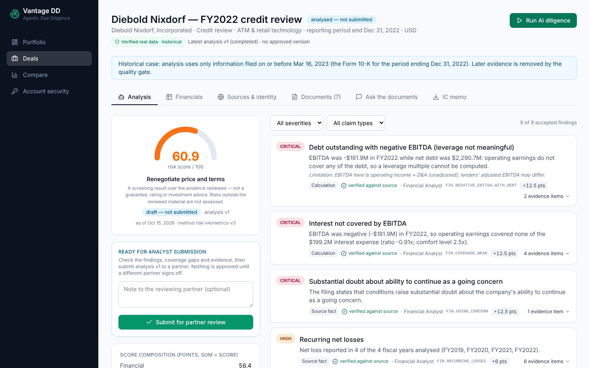
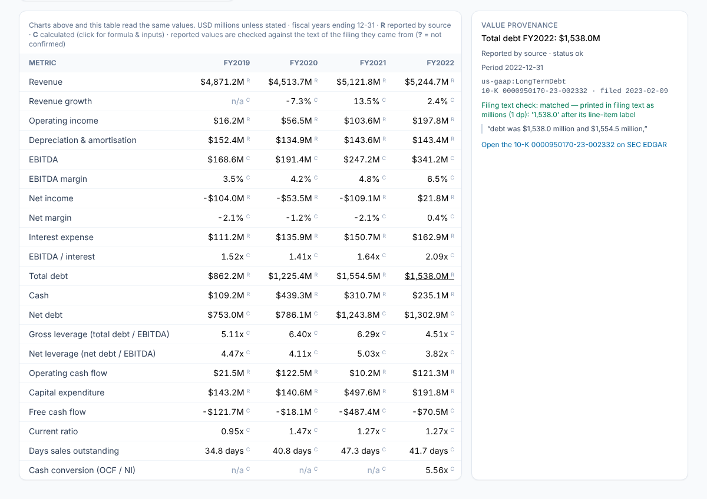
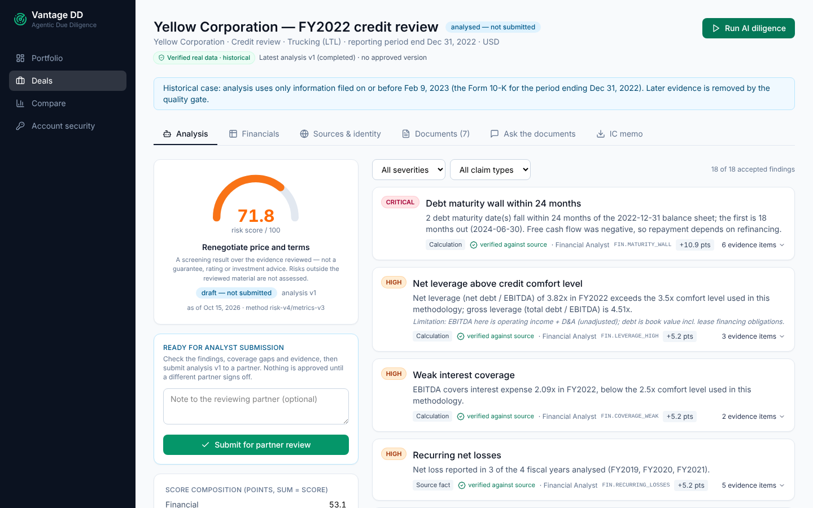
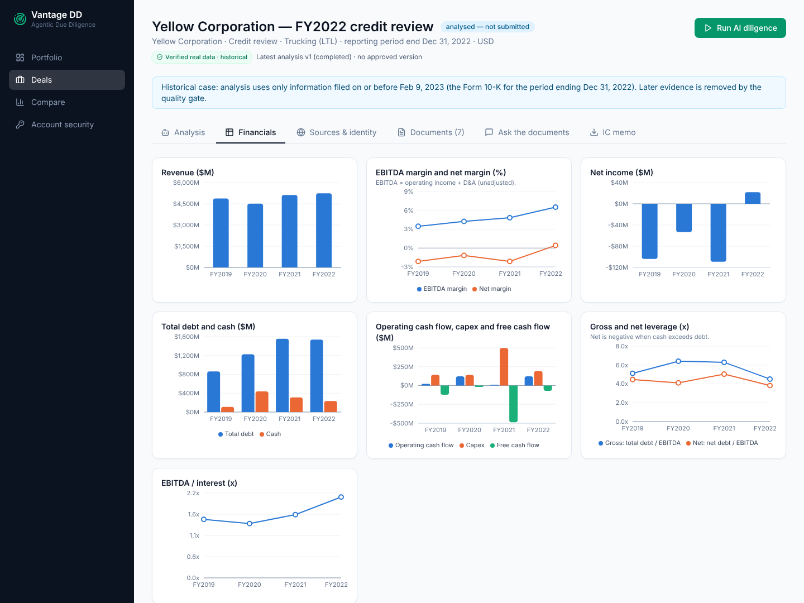
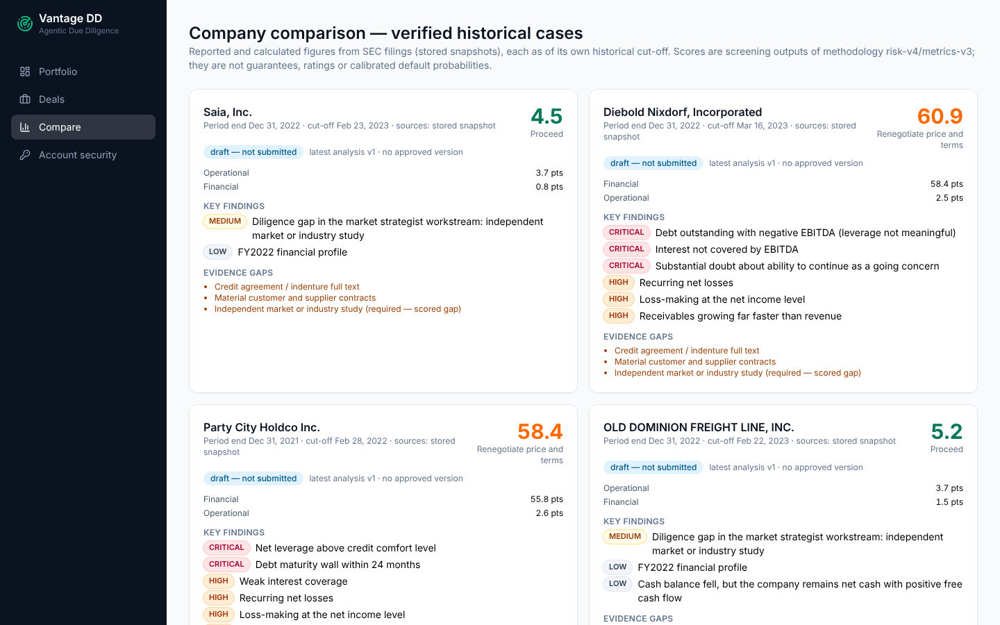
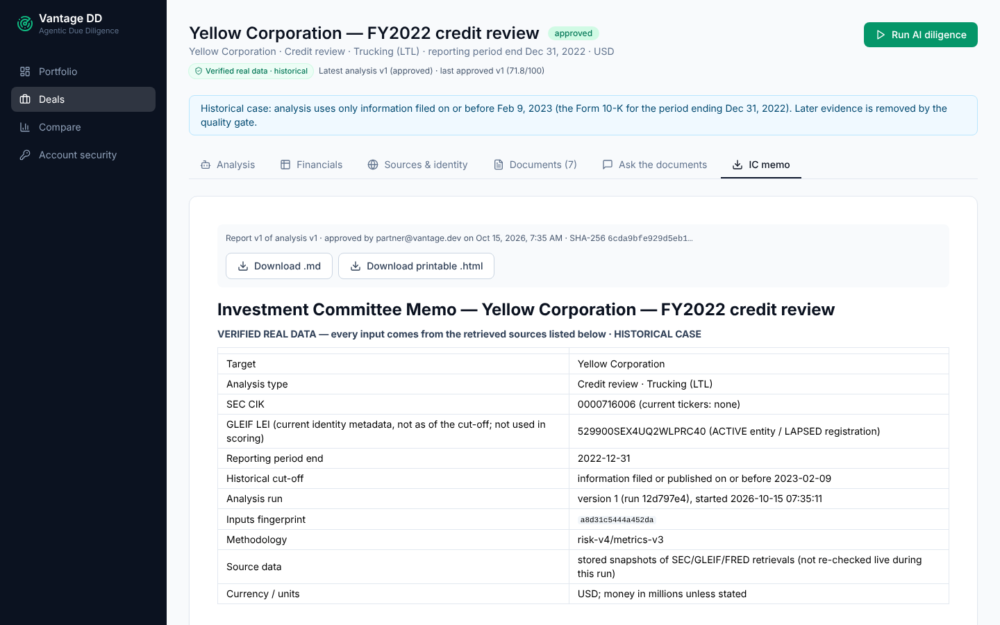
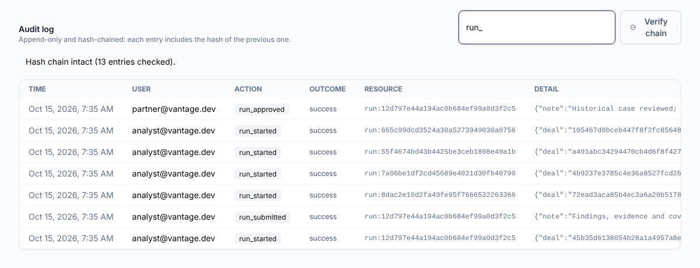
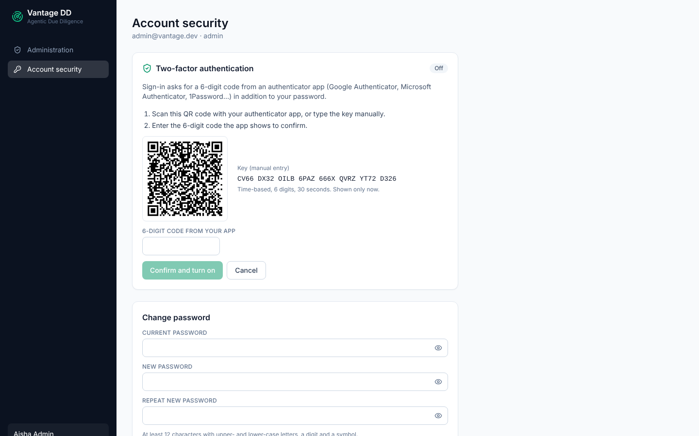
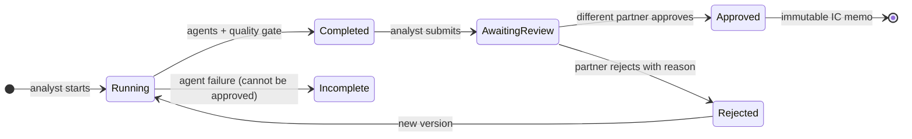

<div align="center">

# Vantage DD

### Multi-agent AI due diligence on real SEC filings — every number traced to its source, every conclusion signed off by a partner




</div>

---

## The business problem

Before a lender extends credit or an investor signs a deal, a team works through hundreds of pages of annual reports,
contracts and data-room files. It is slow, and three things regularly go wrong:

| Problem | Why it matters |
|---|---|
| **Red flags are missed under time pressure** — a maturity wall, a covenant waiver, a going-concern warning buried in a 200-page 10-K | Losses come from what nobody read |
| **AI output cannot be trusted as-is** — language models summarise fluently but can invent numbers and quotes | An investment committee cannot act on an unverifiable claim |
| **No audit trail** — who looked at what, which version was approved, on which evidence | Regulators, auditors and partners need to reconstruct every decision |

## What Vantage DD does

```
SEC filings + data room  →  AI specialist agents  →  every claim re-verified  →  analyst submits  →  partner approves  →  immutable IC memo
```

1. **Pulls the evidence.** Annual reports and XBRL financials from SEC EDGAR, legal identity from GLEIF, interest
   rates from FRED, plus uploaded data-room files. Only information filed **before the decision date** is used.
2. **Analyses it like a deal team.** A supervisor agent sends the case to four specialists in parallel — financial,
   legal, market, ESG/compliance — then a red-team agent challenges management's claims.
3. **Verifies before anyone sees it.** A quality gate rejects any finding whose number or quote is not in its cited
   source. Every reported figure is located in the filing text; every ratio shows its formula and inputs.
4. **Keeps humans accountable.** An analyst reviews and submits; a *different* partner approves or rejects with a
   reason. The approved memo is frozen (SHA-256) and every action lands in a hash-chained audit log.

## Results on five real companies

All figures come from each company's own 10-K, analysed as of its filing date (no hindsight).

| Company (10-K used) | Risk score | Recommendation | What happened afterwards |
|---|---|---|---|
| **Yellow Corporation** (FY2022) | **71.8** | Renegotiate price and terms | Shut down Jul 2023, Chapter 11 Aug 2023 |
| **Diebold Nixdorf** (FY2022) | **60.9** | Renegotiate price and terms | Chapter 11, Jun 2023 |
| **Party City** (FY2021) | **58.4** | Renegotiate price and terms | Chapter 11, Jan 2023 |
| **Old Dominion Freight Line** (FY2022) | **5.2** | Proceed | Healthy |
| **Saia** (FY2022) | **4.5** | Proceed | Healthy |

**Read this honestly.** Scores are screening outputs, not default probabilities. Yellow's rules were written after
reading its filing. Party City, Diebold and Saia were a **pre-registered blind test**: expectations were committed
to git *before* their data was loaded. The blind result was **2 of 3** — Diebold was missed (37.0), which exposed
a data-mapping bug, a missing going-concern rule and a leverage rule that skipped negative EBITDA. All three were
fixed for every company; Diebold now scores 60.9 but no longer counts as blind.
Full account: [`docs/evidence/blind_benchmark.md`](docs/evidence/blind_benchmark.md).

<table>
<tr>
<td width="50%"><br><sub><b>Diebold Nixdorf:</b> negative EBITDA with $2.3bn net debt, interest not covered, going-concern doubt — each verified against the filing.</sub></td>
<td width="50%"><br><sub><b>Provenance:</b> click any number to see its XBRL tag, the 10-K it came from, and the exact sentence where it is printed.</sub></td>
</tr>
</table>

## Why the numbers can be trusted

| Check | Result |
|---|---|
| Reported values located in the text of their own filing | **232 of 236** printed; 4 are sums of separately printed lines (labelled "composite") |
| Independent re-derivation from a *different* SEC endpoint, Decimal arithmetic | **0 discrepancies** across 236 values and 230 ratios ([report](docs/evidence/sec_independent_reconciliation.md)) |
| Source → database → API → screen → approved memo | **PASS for all five companies** |
| Missing data | shown as `n/a` with the reason — never as 0 |
| Gross vs net leverage | both shown and labelled (Yellow FY2022: 4.51x gross, 3.82x net) |
| Current vs historical information | every source labelled (e.g. today's legal identity is never used in a 2023 score) |

## Product tour

<table>
<tr>
<td width="50%"><br><sub><b>Analysis:</b> findings by severity, claim type and verification status; score composition shows the points behind the score.</sub></td>
<td width="50%"><br><sub><b>Financials:</b> four years of reported (R) and calculated (C) figures; the charts and table read the same stored values.</sub></td>
</tr>
<tr>
<td><br><sub><b>Comparison:</b> five companies side by side, each as of its own cut-off.</sub></td>
<td><br><sub><b>IC memo:</b> exists only after partner approval; frozen, hashed, downloadable as Markdown or printable HTML.</sub></td>
</tr>
<tr>
<td><br><sub><b>Audit trail:</b> who started, submitted and approved each version; the hash chain can be verified from the UI.</sub></td>
<td><br><sub><b>Account security:</b> two-factor sign-in, admin-issued one-time password-reset links, mandatory 2FA per role.</sub></td>
</tr>
</table>

## Architecture


**Analysis lifecycle**



Design choices that matter in a regulated setting:

* **Deterministic numbers, AI for reading.** Ratios are computed by code from reported values; the agents find,
  connect and explain evidence. Any number an agent writes must match its cited evidence, or the quality gate
  rejects the finding.
* **Point-in-time discipline.** Facts filed after the analysis date are excluded and flagged; later restatements
  are noted, not mixed in.
* **Separation of duties.** The person who ran or submitted an analysis can never approve it; concurrent approvals
  resolve to exactly one.
* **Fail closed.** An agent failure produces an incomplete run that cannot be approved; startup never alters an
  existing database; production refuses demo mode and weak secrets.

More: [`ARCHITECTURE`](docs/ARCHITECTURE.md) · [`METHODOLOGY`](docs/METHODOLOGY.md) · [`PERMISSIONS`](docs/PERMISSIONS.md) · [`OPERATIONS`](docs/OPERATIONS.md)

## Quality and security evidence

| Area | Evidence |
|---|---|
| Automated tests | 162 backend (SQLite **and** PostgreSQL 16), 20 frontend, 4 end-to-end browser journeys |
| AI evaluation | Quality gate passed: issue recall 1.00, rejection rate 0.00, 0 critical false positives ([report](docs/evidence/eval_report.json)) |
| Security scans | Bandit and authenticated OWASP ZAP active scan: 0 open high/medium/low ([summary](docs/evidence/security_scans.md)) |
| Dependencies | `pip-audit` and `npm audit`: 0 known vulnerabilities |
| Load | 0 errors at 10 / 25 / 50 concurrent users ([measurements](docs/evidence/load_test.md)) |
| Identity & access | bcrypt, httpOnly cookies + CSRF, token rotation and revocation, 2FA (RFC 6238), rate limiting, role + deal-membership checks |
| Release report | [`docs/FINAL_RELEASE_REPORT.md`](docs/FINAL_RELEASE_REPORT.md) — every defect found, every fix, exact results |

## Tech stack

**Backend** Python 3.13 · FastAPI · SQLAlchemy 2 + Alembic · PostgreSQL / SQLite · LangGraph · LangChain (optional
Claude or OpenAI) · hybrid RAG (embeddings + BM25) · MCP server · MLflow · scikit-learn + LoRA-fine-tuned
DistilRoBERTa clause classifier<br>
**Frontend** React 18 · TypeScript · React Router 7 · Vite 7 · Tailwind 4 · Recharts<br>
**Quality** pytest · Vitest · Playwright · ruff · Bandit · OWASP ZAP · GitHub Actions

## Run it locally (Windows, no Docker)

Requires **Python 3.13** and **Node.js 20.19+ / 22 LTS**.

```powershell
powershell -ExecutionPolicy Bypass -File scripts\windows\setup.ps1   # dependencies, .env, build, new database
powershell -ExecutionPolicy Bypass -File scripts\windows\start.ps1   # open http://127.0.0.1:8000
powershell -ExecutionPolicy Bypass -File scripts\windows\test.ps1    # full test suite
```

Setup prints a random demo password once and stores it in your local `.env` (`VANTAGE_SEED_PASSWORD=`, never
committed). Sign in as `analyst@vantage.dev`, open **Yellow Corporation**, click **Run AI diligence**, submit, then
sign in as `partner@vantage.dev` to approve and download the memo. Works offline from stored SEC snapshots; set
`VANTAGE_SOURCE_MODE=live` to re-fetch. macOS/Linux steps: [`docs/OPERATIONS.md`](docs/OPERATIONS.md).

## Repository map

```
backend/app/agents      LangGraph supervisor, specialists, red team, quality gate, report builder
backend/app/sources     SEC / GLEIF / FRED clients, point-in-time XBRL extraction, filing reconciliation
backend/app/analytics   metric registry (formula + inputs), strengths, display rules
backend/app/api         REST API, roles, approval workflow, audit
frontend/src            React dashboard
ml/                     evaluation set (incl. pre-registered blind benchmark), clause-model training
scripts/                setup, independent SEC reconciliation, source-to-screen check, load test
docs/evidence           raw outputs of every check in the release report
```

## Limitations

An independent project, not a certified production system. No single sign-on (needs a company identity provider);
no independent penetration test; no real language model evaluated (rules-only mode was measured); one server
process (~40 requests/s on 2 vCPUs); five real companies are far too few to validate scores as predictors.
Details in the [release report](docs/FINAL_RELEASE_REPORT.md#10-remaining-limitations-not-done).

---

<sub>Built by Shraddha Todkari · 2026 · Not investment advice. SEC, GLEIF and FRED data are public; every figure is
reproducible with the scripts in this repository.</sub>
