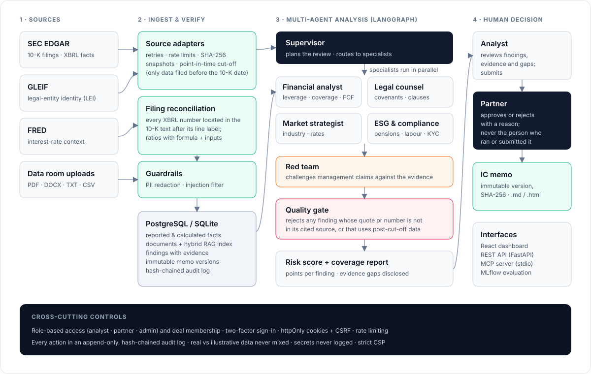

# Architecture



## Authoritative data flow (one path for every number)

1. **Retrieval** (`backend/app/sources/`): `http.py` fetches with timeouts, bounded retries, backoff and rate
   limiting; stores raw bytes content-addressed in `data/source_snapshots/` with `manifest.json`
   (URL → sha256, bytes, UTC retrieval time). `sec.py` (submissions, XBRL company facts, 10-K document),
   `gleif.py` (exact-match LEI lookup), `fred.py` (FEDFUNDS series).
2. **Provenance records** (`SourceRecord`): one row per retrieval (source, URL, accession, form, filing date,
   period, retrieved_at, mode, sha256). Duplicate retrievals are de-duplicated by (url, sha256).
3. **Facts** (`FinancialFact`, kind=`reported`): point-in-time XBRL values for four fiscal years with tag,
   accession, form, filing date, period, restatement flag — or validated rows from an uploaded CSV for
   non-SEC deals. **Calculations** (kind=`calculated`) are materialised from facts with formula and inputs.
4. **Documents**: the 10-K is converted to normalised text and split into Items; each kept Item becomes a document
   with source URL, accession and its offset in the full filing. Uploaded files pass PII redaction and
   injection neutralisation first. The stored text is exactly what agents read and what evidence locators index.
5. **Agents** (`backend/app/agents/`): read facts and documents through `evidence.load_context`, emit findings
   with typed evidence (excerpt + locator, reported fact, calculation, assumption, FRED series).
6. **Quality gate** re-verifies every finding against the database and documents (see METHODOLOGY §3).
7. **Persistence**: `AnalysisRun` (per-deal version, inputs hash, methodology version, agent errors), `Finding`,
   `RunEvent`; LangGraph checkpoints in SQLite so a paused review survives restarts.
8. **Approval** renders the memo from the persisted findings into an immutable `ReportVersion` (content and
   findings sha256). The UI and the `.md` export serve the same stored content.
9. **API → UI**: the React app only displays API data; there are no hard-coded business values. Illustrative,
   user-supplied and verified-real deals are separated in every aggregate.

## Agent graph

```
START → supervisor ─┬─► financial_analyst ─┐
                    ├─► legal_counsel ─────┤  parallel (Send), reducers merge findings/events/errors
                    ├─► market_strategist ─┤
                    └─► esg_compliance ────┘
                                           ▼
                             red_team → quality_gate ─┬─ any agent failed → END (status incomplete)
                                                      └─► human_review (interrupt) → END
```

Each node runs inside `safe_node`: an exception becomes an `agent_errors` entry and an error event; the run is then
`incomplete` and cannot be approved. Runs left `queued`/`running` by a crash are marked `failed` at startup.
One active run per deal is enforced (process lock + DB check; version numbers are unique per deal).

| Agent | Inputs | Typical findings |
|---|---|---|
| Financial analyst | facts, calculations, notes/MD&A/risk factors, FRED | leverage, coverage, FCF, losses, maturity wall, covenant tests, PIK, waivers, floating-rate exposure |
| Legal counsel | contracts, legal memos, Item 3 | clause families, litigation, concentration, payment terms |
| Market strategist | market documents | growth vs market, margin vs peers, pricing pressure |
| ESG & compliance | ESG, compliance, risk factors, notes | pensions, unionisation, labour-agreement expiry, PCI/AML/KYC |
| Red team | management documents + other agents' findings | contradictions between statements and evidence, missing refinancing discussion, embedded instructions |

An optional LLM pass (Claude/OpenAI) can propose extra findings, but it must quote documents verbatim; quotes that
cannot be located are rejected by the quality gate.

## Security model

Cookie sessions (httpOnly, SameSite=Strict, Secure in prod) with short-lived access tokens, single-use rotating
refresh tokens, server-side revocation on logout, double-submit CSRF tokens for state-changing requests, bcrypt
(cost 12) with constant-time checks for unknown users, generic login errors, per-IP+email rate limiting and
account lockout, explicit permission matrix plus deal membership on every endpoint, security headers (CSP,
frame-deny, no-store, HSTS when secure), audit of denials. See PERMISSIONS.md.

## Storage

SQLite (WAL mode, foreign keys on) by default; Postgres URL supported by SQLAlchemy/Alembic (the append-only
triggers have a Postgres variant). Vector index: local numpy files (pgvector optional).
